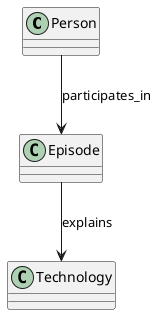

# オントロジーをコードとして扱う：YAML・AST・Mermaid・PlantUML

## 結論

オントロジーを YAML で定義し、AST で構造化・検証し、Mermaid（MMD）と PlantUML（PUML）で可視化する。

ただし、それぞれの役割を分けることが重要。YAML・AST・MMD・PUMLを別々に手で管理するのではなく、YAMLを定義の正本にして、AST／中間表現を介して図を生成する。

## 1. 形式ごとの役割

| 形式 | 役割 | 得意なこと |
|---|---|---|
| YAML | 定義・管理 | 概念、属性、関係、制約を記述 |
| AST | 構造化 | 構文を解析し、機械が扱える構造にする |
| Mermaid（MMD） | 手軽な可視化 | 関係図、フロー、依存関係 |
| PlantUML（PUML） | 詳細な設計図 | クラス図、シーケンス図、システム構造 |

基本のデータフロー：

```text
          ontology.yaml
                │
                ▼
         Parser / Validator
                │
                ▼
              AST
        ┌───────┼───────┐
        ▼       ▼       ▼
    Mermaid  PlantUML  JSON
      .mmd     .puml    .json
```

AST は Abstract Syntax Tree（抽象構文木）。YAMLを解析して得られる構造を、そのままASTと呼べるとは限らない。オントロジー用の中間表現としてASTを設計すると、より明確になる。

## 2. オントロジーをYAMLで定義する

例えば「親子対話」シリーズなら、概念と関係を定義できる。

```yaml
id: oyako-dialogue
title: 娘と父のAIレシピ
version: 1.0

concepts:
  Person:
    properties:
      - name
      - role

  Episode:
    properties:
      - title
      - topic
      - dialogue

  Technology:
    properties:
      - name
      - category

relations:
  - from: Person
    to: Episode
    type: participates_in

  - from: Episode
    to: Technology
    type: explains

instances:
  - id: cortex-search
    type: Technology
    name: Cortex Search
    category: information_retrieval
```

この例では `Episode` は作品を表す概念で、通し番号は持たせていない。

さらに、次のような制約も定義できる。

- `Person` の役割は「娘」または「父」。
- `Episode` はタイトルを持つ。
- `Technology` は複数の作品から参照できる。
- 同じ技術を別の作品で扱っても、概念の定義は重複させない。

これにより、作品同士の知識もつながる。

## 3. ASTを挟む利点

YAMLに次の関係があるとする。

```yaml
relations:
  - from: Episode
    to: Technology
    type: explains
```

ASTでは、これを単なる文字列ではなく、構造として扱う。

```text
Relation
├── from: Episode
├── to: Technology
└── type: explains
```

この構造を使えば、プログラムで以下を検証できる。

1. 存在しない概念を参照していないか。
2. 関係の接続先が正しいか。
3. 必須の属性が定義されているか。
4. 図やJSONへの変換に失敗しないか。

ASTは、オントロジーを検査・変換するための中間表現として使う。

## 4. MMDとPUMLを同じ情報から生成する

概念間の関係をMermaidで表す例：


PlantUMLで表す例：



同じ定義から両方を生成すれば、図ごとに関係が食い違う問題を減らせる。

Mermaidは関係の俯瞰、PlantUMLは詳細な設計図など、用途に応じて表示する情報を変えてよい。

## 5. Ontology → AST → IR

本格的にエージェントや複数のツールに展開するなら、ASTとIRを分ける。

| 層 | 役割 |
|---|---|
| Ontology | 世界の概念・意味・関係を定義 |
| Parser | YAMLを解析 |
| AST | YAMLの構文構造を保持 |
| IR | ツールに依存しない共通の意味構造 |
| Generator | MMD・PUML・JSON・SQLなどに変換 |

厳密には、ASTは構文に近く、IR（Intermediate Representation：中間表現）は処理しやすい意味構造に近い。

YAMLの書き方を変更しても同じIRを生成できれば、図やデータ出力側への影響を小さくできる。

オントロジーの厳密な意味論まで必要になったら、RDF・OWLとの連携も選択肢になる。

## 6. リポジトリ構成案

```text
ontology/
├── concepts.yaml
├── relations.yaml
├── constraints.yaml
└── schemas/
    └── ontology.schema.json

compiler/
├── parser
├── validator
├── ast
├── ir
└── generators/
    ├── mermaid
    ├── plantuml
    └── json
```

まずはYAMLとJSON Schemaで定義・検証を始め、必要になった段階でASTとIR、各種ジェネレーターを実装する。

## まとめ

YAMLを正本にして、ASTで解析・検証し、IRからMMD・PUML・JSONを生成する。

これならオントロジーを単なる文書ではなく、GitHubで管理できる「知識のソースコード」として扱える。

さらに、オントロジー自体をエージェントが読み、必要な知識・ツール・担当エージェントを選ぶためのルーティング基盤にできる。図を描くためだけでなく、Bonsaiのエージェント群が知識を共有するための共通言語にする構想である。
